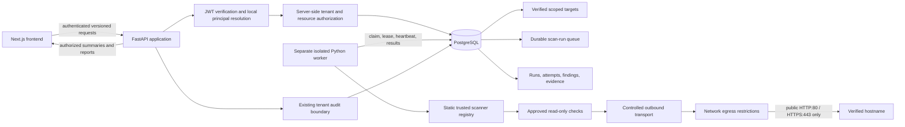

# Phase 3 architecture, security threat model, and implementation blueprint

## Status and scope

The product owner has approved the nine architecture decisions listed near the end of this
document and formally signed off and closed Phase 3A. Phase 3B is authorized. This specification
records intended behavior; it does not claim that DNS TXT ownership verification, secure DNS
resolution, scanning, queue, worker, result API, or UI has been implemented. Phase 3B is underway.
Phase 3B.1 hostname canonicalization is implemented and pending final acceptance. Phase 3B.2
organization target and verification-challenge persistence is implemented as a foundation only;
issuing, rotating, or consuming a challenge does not establish DNS ownership or mark a target
verified. No target API or issuance rate limit is implemented; enforce rate limits before exposing
challenge operations.

The design preserves the Phase 2 identity, tenancy, authorization, audit, lifecycle, and scan-record
foundations. It keeps the backend a modular monolith, adds a separately run Python worker, uses
PostgreSQL as the initial durable queue, and limits initial scanning to read-only checks against
verified exact hostnames on HTTP port 80 and HTTPS port 443.

### A. Current-state architecture

The repository is a pnpm/uv monorepo:

- `apps/web` is a Next.js App Router application with TypeScript. It currently provides a static
  landing page and has no authentication flow, API client, or scan workflow.
- `apps/api` is a FastAPI application using Pydantic, SQLAlchemy 2.x, and Alembic. It contains
  modular identity, tenancy, scans, and audit foundations.
- PostgreSQL is the architectural database and is used by local Docker Compose and CI integration
  tests. There is no selected production database provider or production deployment.
- The repository includes Vitest, Pytest, Playwright, and a separate PostgreSQL integration-test
  path.

Implemented Phase 2 capabilities include configured JWT access-token verification, local identity
resolution, active-account checks, personal and organization scopes, organization membership and
role authorization, organization/account lifecycle operations, scan-record persistence, explicit
unit-of-work transactions, PostgreSQL concurrency validation, and durable database audit events.
These are application foundations, not a production security certification or deployed control
plane.

The `security_scans` table and protected scan routes currently create, list, and retrieve records
within personal or organization scope. A scan-create request has no target or execution options;
the record has no run state, findings, or evidence. **Existing scan creation is persistence only:
it does not make a network request or perform a scan.** There is no target verification, scanner
registry, queue, worker, progress/cancellation API, finding analysis, report, or scan-result UI.

Phase 2 organization scan-record permissions remain unchanged: OWNER, ADMIN, and MEMBER may create
records; all four roles, including VIEWER, may read/list records. Phase 3 target management,
execution, findings, normalized evidence, and cancellation are new resources with the distinct
approved permission matrix in section G. That future matrix does not retroactively alter the Phase 2
record API.

See the [architecture overview](./overview.md), [Phase 2 roadmap](./phase-2-roadmap.md), and
[architecture decisions](./decisions.md) for implemented foundations and their limits.

### B. Target architecture and trust boundaries



Component responsibilities:

- **Next.js frontend:** collect a target and scan request, present authorization-safe lifecycle
  states and results, and display only evidence the signed-in user may see. The UI is not an
  authorization boundary.
- **FastAPI application:** authenticate the caller; authorize every operation using current local
  identity, organization, membership, role, resource scope, and target-verification state; validate
  requests; persist a scan request and its queueable run atomically; expose scoped status and
  results. It must not perform long-running network scanning in the request process.
- **PostgreSQL:** hold tenant-scoped targets and verification state, scan records, run lifecycle,
  attempts, normalized findings/evidence, audit events, quotas, and durable queue state.
- **Python worker:** claim server-created work, enforce leases and bounded execution, invoke only
  registered trusted modules, emit bounded typed output, and persist results. It has no public
  listener and does not receive user bearer credentials. Its database identity must not perform
  identity-management or privileged account operations, modify organization membership or roles,
  create arbitrary tenant jobs, or modify authorization state. It may access only the job and
  operational records needed for work assigned by server-created jobs; tenant and run scope must
  be established by those jobs and validated again when persisting output. Exact SQL grants and
  their implementation are deferred to 3C/3D.
- **Static scanner registry:** select only built-in, versioned scanner implementations. No runtime
  imports, uploaded plugins, shell execution, or user-supplied scanner code.
- **Outbound transport and network controls:** enforce exact target host, validated/pinned
  destination address, permitted scheme/port, TLS/SNI validation, no automatic redirects, and hard
  resource limits. A network firewall/egress policy is a separate defense from application checks.
- **Results/reporting:** APIs return a finding summary or detailed normalized evidence only after
  authorization. Reports are derived from persisted, versioned results; no third-party reporting or
  paid service is required.

Trust boundaries exist between browser input and the API; verified identity and local authorization;
the API and worker queue; worker code and untrusted DNS/target responses; and the worker's
application-level network policy and the deployment's network egress controls. Database locks are
for short state transitions only; they must never be held across DNS, TLS, or HTTP operations.

### C. Target verification and outbound security

#### DNS TXT verification lifecycle

1. An authenticated caller requests a target under a personal scope or an organization scope. The
   server canonicalizes the input as a hostname, not a URL. An organization target can be created
   or managed only by OWNER or ADMIN; a personal target is managed only by its owner.
2. The server generates an unpredictable, single-use challenge with at least 256 bits of
   cryptographic randomness. It returns the value once, with instructions to publish a TXT record
   at a dedicated name such as `_threatsentinel-verification.<exact-hostname>`. The challenge value
   is never logged.
3. Persist only a cryptographic hash (or keyed HMAC) of the challenge, target and actor/scope
   identifiers, issue time, and bounded expiry. Do not persist the raw challenge or return it again
   after the initial issuance response. Rate-limit issuance and verification; invalidate superseded
   challenges.
4. An explicit verification operation queries TXT records using a bounded resolver. Accept only an
   exact challenge match for the requested exact hostname and unexpired challenge. On success,
   atomically consume the challenge and record verification time, method, and policy version.
5. Verification is scope-bound. An organization member cannot reuse a personal target's
   verification or transfer it across organizations. A subdomain requires its own separate
   challenge. Wildcards and IP-address targets are not accepted.
6. Verification expires or can be revoked. Before admission and again before execution, require a
   currently verified target. If a target is no longer authorized/verified, fail closed and do not
   connect. A target's ownership proof establishes control at verification time; it does not prove
   that a resolved IP is safe to contact.

Hostname canonicalization is implemented in Phase 3B.1 with the Python `idna` library using UTS #46
non-transitional processing and STD3 ASCII rules, including Unicode normalization and A-label/
U-label round-trip validation. It returns lowercase ASCII A-labels, removes one optional trailing
DNS root dot, and enforces a 253-octet hostname limit, 63-octet label limits, and at least two
non-empty labels. It rejects surrounding or embedded whitespace, URLs and their components, IP
literals and identifiable alternate numeric IP forms, wildcards, malformed separators, and
invalid IDNA labels. It does not trim or repair malformed input. This is syntactic canonicalization
only: it does not prove DNS resolution, public address status, ownership, authorization, or
permission to scan. DNS TXT ownership verification remains a separate required step. The IDNA
profile and library choice are resolved for Phase 3B.1; DNS resolver/client and other verification
decisions remain open for their respective Phase 3B milestones.

#### Per-connection DNS and IP safety

Before every new outbound connection, resolve A and AAAA records through a bounded resolver and
validate the complete answer set before opening any connection. Query both A and AAAA; follow
CNAMEs only up to a maximum of 8 links, reject loops, and cap the combined terminal A/AAAA answer
count at 32 addresses. Each DNS message is limited to 64 KiB and 128 resource records. Each DNS
operation has a 3-second timeout and complete A/AAAA-plus-CNAME resolution has a 10-second
deadline. These are selected initial baseline defaults approved in Phase 3A. If a DNS response is
truncated, retry that query once over TCP within the
original 10-second overall deadline; if it is still truncated or cannot be completed within that
deadline, fail closed. Do not retry timeout, SERVFAIL, or other incomplete/ambiguous results; fail
closed instead.

Require complete, consistent resolution of both address-family queries: an explicit no-data
answer for one family is acceptable, but a timeout, resolver error, malformed chain, or otherwise
incomplete answer for either family rejects the resolution. At least one terminal address must be
returned. Validate every terminal A and AAAA address, including the final destination reached
through each CNAME chain. Reject the hostname if any answer is private, loopback, link-local,
multicast, unspecified, reserved, shared/special-use, otherwise non-global, malformed, or
prohibited by policy. Reject mixed public/prohibited answers rather than selecting only the
public address. Apply equivalent policy to IPv4 and IPv6, including IPv4-mapped IPv6 and
transition addresses that could evade the intended policy. Where the platform's address
classification is ambiguous, deny by default and maintain explicit special-use range tests.

No network connection may occur until all relevant DNS answers have been received and validated.
The HTTP transport must connect to a validated, pinned IP address from that resolution, not
perform an uncontrolled second hostname lookup. Preserve the canonical hostname for HTTP Host,
TLS SNI, and certificate hostname verification. Do not disable certificate validation. A new
connection requires a fresh resolution and complete validation; connection pooling must not allow
an address checked for one hostname or policy context to be reused for another.

This prevents DNS rebinding between application validation and the connection when correctly
implemented, but application controls are not sufficient on their own. The worker's separate
network-level egress policy must independently block loopback, private, link-local, metadata,
container/service, database, and other internal address ranges for both IPv4 and IPv6, including
after routing/NAT. The network policy must permit only the required DNS resolution mechanism and
HTTP/HTTPS egress. Docker Compose isolation alone does not establish this control.

#### Request behavior and limits

- Permit HTTP port 80 and HTTPS port 443 only. Do not accept arbitrary ports, IP address targets,
  or target-specified proxy settings.
- Allow only GET and HEAD, and only when a specific registered scanner declares and is approved
  to use that method. Send no request bodies, authentication credentials, cookies, or
  user-supplied headers; scanner-owned headers must be a reviewed fixed allowlist. Do not accept
  user-supplied arbitrary URL paths. Initial checks request only the registered target origin's
  root path (`/`); do not crawl or fetch linked/arbitrary resources.
- GET and HEAD do not guarantee that a remote server has no side effects. They are a narrow
  request-method boundary, not proof of target behavior; retain the read-only intent, authorization,
  rate/resource limits, and conservative handling of every request.
- Treat redirect responses as observations only. Never automatically follow a redirect or request
  its destination. Any future redirect feature requires separate approval and must independently
  validate the destination hostname, scope/allowlist policy, DNS answers, IP pinning, scheme/port,
  and TLS for every hop.
- Use these initial request deadlines, each capped by the total HTTP request deadline:
  TCP connection establishment 3 seconds; TLS handshake 5 seconds; first response byte 5 seconds;
  subsequent response-read inactivity 2 seconds; total HTTP request 10 seconds. Start the total
  deadline before TCP connection establishment; it covers TCP, TLS, waiting for the first byte,
  and all response reads. Individual phase timeouts are upper bounds only and must never extend or
  reset the total deadline.
- The initial transport uses HTTP/1.1 only for both HTTP and HTTPS. For TLS, offer only `http/1.1`
  through ALPN. Reject any negotiated application protocol other than HTTP/1.1; do not retry or
  silently fall back to another protocol. If the peer selects no ALPN protocol, proceed only when
  the transport can guarantee HTTP/1.1. Do not use HTTP/2, HTTP/3, or QUIC in the initial
  implementation. Defer HTTP/2 and HTTP/3 until equivalent header, byte, decompression, timeout,
  concurrency, and resource accounting is specified, approved, implemented, and security-tested.
- Limit concurrency to 2 outbound connections per scan and 2 connections to the same hostname per
  scan; limit a worker process to 8 outbound connections total. The initial deployment uses one
  worker process. Do not enable multiple worker processes or production replicas until an aggregate
  deployment-wide outbound concurrency limit is implemented and tested.
- Limit each HTTP response to 64 headers and 32 KiB aggregate response-header bytes. Limit its
  encoded response body to 1 MiB after transfer framing is decoded but before content
  decompression, and its decompressed response body to 2 MiB. Count response header fields and
  trailer fields together toward the 64-field and 32-KiB limits. The aggregate header-byte limit
  includes the status line and the complete header and trailer field lines, including their
  delimiters. Bound every individual line to 8 KiB; the aggregate limit also bounds the total
  header/trailer section. Limit each response message to 2 MiB of transferred response-message
  octets, including headers and transfer-coding framing. These limits apply while parsing the
  stream, not after buffering it.
- Limit each scan to 5 MiB of cumulative transferred response bytes, 5 MiB of cumulative
  decompressed response bytes, 20 HTTP requests, and 120 seconds of total scan execution duration.
  The 120-second wall-clock budget covers the logical scan execution, including retries and
  backoff; queue wait before execution begins is outside this execution budget.
- Define a response message's transferred-byte count as each HTTP/1.1 response-message octet
  received after TLS decryption and before transfer decoding. Include the status line; response
  header and trailer fields and their line delimiters; transfer-coding framing (including chunk
  size lines, chunk delimiters, and the terminal chunk); and encoded response-body octets. Exclude
  request bytes and TLS, TCP, and IP framing. This is not a count of total network-wire bytes.
  Count each octet exactly once in the response-message count: trailer octets are included there
  and also contribute to the aggregate header accounting, but are not added a second time to the
  message-byte count.
- Distinguish the three byte measures: transferred response-message octets are counted before
  transfer decoding; encoded body octets are counted after transfer framing is decoded and before
  content decompression; decompressed content bytes are counted after content decompression.
  Enforce the per-response encoded-body, decompressed-body, header/field, and response-message
  limits independently from the per-scan transferred-message and decompressed-byte budgets, as
  each stream is consumed. The per-scan transferred budget is the sum of response-message octets
  across responses; overlapping header/trailer accounting does not add extra message octets.
- Use an incremental HTTP/1.1 parser with bounded line/header storage and bounded decompressor
  output. For body-bearing responses, accept only one valid `Content-Length` or one `chunked`
  transfer coding without `Content-Length`; handle no-body response semantics as defined by
  HTTP/1.1. Reject close-delimited bodies, duplicate or invalid length declarations, simultaneous
  transfer encoding and content length, stacked or unsupported transfer codings, unsupported
  content codings, obsolete folded headers, malformed chunk framing, excess bytes, and incomplete
  messages. Never fall back to a different protocol or framing interpretation. Do not expose
  parsed fields or body content to a scanner before the relevant limits are enforced, and do not
  buffer an unbounded body or allocate according to an untrusted message-length declaration. The
  specific supported content-coding allowlist and parser implementation are Phase 3E decisions;
  unsupported encodings fail closed.
- Malformed DNS, inconsistent answers, prohibited addresses, TLS errors, timeouts, excess bytes,
  or policy uncertainty must fail closed with a typed bounded result and no fallback request.

#### Security boundaries and numeric-limit approval gate

The immutable security boundaries are not deployment-tunable: exact verified hostnames only;
HTTP:80/HTTPS:443 only; the approved GET/HEAD request boundary; origin-root only; no request
bodies, credentials, cookies, user-supplied headers or paths; no automatic redirects; complete DNS
validation before connection; validated pinned destination addresses; TLS hostname verification;
HTTP/1.1 only; and fail-closed behavior on policy uncertainty. Scanner modules and operators cannot
relax these boundaries.

The DNS, HTTP, concurrency, response-size, per-scan budget, and duration numbers above are the
selected initial baseline defaults approved in Phase 3A. These finite limits are deployment
settings only in the sense that a deployment may use stricter values. A deployment or scanner must
not raise them. Enforce them in the shared transport and per-scan execution context; scanner
modules cannot raise or override any shared limit. Phase 3B is authorized; that authorization
does not itself implement any controls or enable production scanning.

### D. Scanner execution contract

The internal contract must be typed, immutable where practical, and versioned independently from
database models and HTTP schemas. Its logical shape is:

```text
ScannerDescriptor:
  scanner_id, scanner_version, evidence_schema_version
  supported_protocols, check_descriptors
  max_duration, max_requests, max_response_bytes, required_capabilities

CheckDescriptor:
  check_id, check_version, title, description, default_severity
  remediation, evidence_schema_version

ValidatedTarget:
  target_id, scope_id, canonical_hostname, verified_at, verification_policy_version

ExecutionContext:
  run_id, attempt_id, idempotency_key, deadline, cancellation_handle
  request_budget, byte_budget, concurrency_budget, policy_version
  progress_sink, observation_sink, finding_sink

ProgressEvent:
  phase, completed_units, total_units?, safe_message_code, occurred_at

Observation:
  observation_type, schema_version, normalized_bounded_value
  source_check_id, source_check_version, observed_at

Finding:
  check_id, check_version, fingerprint, title, description
  severity, confidence, remediation, evidence_references, first_observed_at

StructuredError:
  category, stable_error_code, retryable, safe_summary
```

These are design shapes, not existing Python classes. A scanner receives only a server-validated
target and bounded context. It cannot provide a URL, IP, port, redirect policy, tenant ID, or
resource budget that overrides persisted server policy.

Distinctions and requirements:

- **Observations** are factual, normalized measurements (e.g. the response did not contain a
  particular header). They are not automatically security findings.
- **Findings** are rule-versioned interpretations of one or more observations. They state a
  security-relevant condition, severity, confidence, remediation, and references to normalized
  evidence.
- **Progress** is coarse, bounded, and best effort. It cannot expose raw response data or create an
  unbounded database write stream.
- **Errors** are structured categories such as policy rejection, unsupported protocol, transient
  DNS/network failure, timeout, cancellation, target response limit, and internal scanner error.
  Persist safe codes/summaries, not exception messages, tracebacks, or remote content.
- **Cancellation** is cooperative and checked between operations and during bounded I/O. A hard
  worker deadline must still terminate non-cooperative execution at the process/container level.
- **Versions/provenance** include scanner ID/version, check/rule ID/version, evidence schema,
  execution-policy version, target-verification policy version, worker build/image identifier, and
  run/attempt IDs. Persist these on each run or finding so later interpretation is reproducible.
- **Registry** is explicit and static: a reviewed code change registers a module. Unknown scanner
  or rule IDs fail closed. No reflection-based dynamic imports or arbitrary plugins.

Idempotency has two layers: an API idempotency key (unique within the authenticated principal and
operation) prevents duplicate user submissions; a run-scoped finding fingerprint constraint makes
retries safe. Queue delivery is at-least-once, not exactly-once. A repeated worker attempt may
execute network reads again, but it must not create duplicate findings/evidence for the same
logical run. Preserve attempt provenance rather than claiming exactly-once execution.

### E. Queue and worker lifecycle

#### Admission and claim

The API authenticates and authorizes the caller, confirms the exact scoped target is verified and
within policy, and creates the scan record, logical run, and queued state in one PostgreSQL
transaction. The transaction also records the user action in the existing audit system where
required. A transaction either commits the request and its durable work together or commits neither.
No in-memory task is the source of truth.

Workers poll eligible queued or reclaimable runs. A short transaction selects eligible rows in
stable order using `FOR UPDATE SKIP LOCKED` where appropriate, validates lifecycle and target
state, increments the attempt number, sets a unique lease/fencing token and lease expiry, and
commits. A worker heartbeat renews the lease only when its fencing token still matches. No database
transaction or row lock remains open during DNS, TLS, HTTP, or scanner execution.

#### Lifecycle, recovery, and duplicate protection

Recommended logical run states are `queued`, `running`, `cancel_requested`, `succeeded`,
`partial`, `failed`, and `cancelled`; only documented transitions are permitted. Progress is
coarse and monotonic within a run. Terminal states are immutable except for separately audited
administrative correction if such an authority is ever approved.

- A lease is finite. Heartbeats extend it only while the matching fencing token remains current.
- When a worker crashes or stops heartbeating, a reaper/claim query may reclaim the expired run
  after a bounded grace period. Reclaim increments the attempt and rotates the token. A stale
  worker's subsequent heartbeat/result write is rejected by the token/state check.
- A stale worker may have already issued a read-only request before losing its lease. Leases and
  fencing prevent stale writes and duplicate persisted findings, not the physical impossibility of
  stopping every in-flight network operation. Bound request duration and terminate the worker at
  deadline.
- Classify errors. Retry only explicitly transient categories (e.g. selected DNS/network
  unavailability) with bounded exponential backoff and jitter; do not retry policy rejection,
  unsupported target, cancellation, deterministic malformed response, or internal programming
  errors automatically. Set a finite attempt ceiling; exhausted work becomes `failed` with a safe
  reason code. Retries create new `scan_attempts`, not new logical runs.
- Cancellation is authorized at request time and transactionally moves a nonterminal run to
  `cancel_requested`. A queued run may become `cancelled` without execution. A running worker
  observes cancellation between operations and during I/O, stops issuing requests, and commits
  `cancelled` only with its current fencing token. If cancellation races with a terminal result, a
  row lock/state comparison establishes the winner. Cancellation does not erase existing results.
- A run claim, heartbeat, state transition, and result write are short transactions. Never keep
  locks open across network calls. Duplicate delivery and retries are expected; unique constraints,
  fenced writes, and idempotent upserts prevent duplicate findings.

### F. Data model blueprint

These are proposed responsibilities and relationships except for the Phase 3B.2
`security_targets` and `target_verification_challenges` organization-only persistence foundation,
which is implemented by an additive Alembic migration. B.2 does not implement DNS verification,
scan/run data, or any change to existing records. Preserve existing `security_scans` scope and
creator constraints.

| Entity | Responsibility and relationship |
|---|---|
| `security_targets` | Phase 3B.2 implements organization-owned canonical exact hostnames, creator, and nullable `verified_at` (left unset by challenge operations); a per-organization canonical-host uniqueness constraint prevents duplicates. Future personal scope and verification metadata remain planned. |
| `target_verification_challenges` | Phase 3B.2 stores one SHA-256 hash and issue/expiry timestamps per organization target, never plaintext. Rotation replaces the current hash; revocation, successful consumption, and expired consume attempts remove the challenge row. The persistence-only consume primitive requires an upstream exact DNS TXT match and does not mark the target verified. |
| `security_scans` | Preserve Phase 2 scan record and creator/scope contract. Add a nullable target reference for migration compatibility; new executable scans require a verified target. Existing empty Phase 2 records remain valid and are not given fabricated targets or runs. |
| `scan_runs` | One logical requested execution and durable queue state, target/config snapshot, requester, lifecycle timestamps, bounded progress, cancellation state, current lease/fencing token and expiry, policy/scanner provenance, and API idempotency identity. A scan may have multiple logical runs over time. |
| `scan_attempts` | One worker claim/execution attempt per logical run: attempt number, worker build/identifier, lease provenance, start/end, outcome/error category, and bounded timing. Unique `(run_id, attempt_number)`. Retries append attempts. |
| `scan_findings` | Normalized rule interpretation scoped to a run: stable fingerprint, scanner/check versions, title/summary, severity, confidence, remediation, timestamps/status, and evidence references. Unique `(run_id, fingerprint)`. |
| `scan_evidence` | Minimal normalized observation/evidence scoped to the run and optionally related to a finding: schema/type, bounded structured value, source check/version, observation time, and provenance. Strict payload size and allowed-field validation. Never raw response bodies or secrets. |

Use foreign keys and scope constraints where the relational model supports them. Future target
scope expansion must enforce exactly one personal/organization scope and require a scan/run/target
to agree on scope. Phase 3B.2 enforces organization/target consistency with a composite foreign key.
Prefer composite tenant-aware foreign keys for dependent rows where feasible; otherwise every
repository query and service operation must constrain both resource ID and authorized scope.
Indexes should support target lookup by scope/canonical hostname, queue eligibility by state/next
attempt/lease expiry, run history by scan and creation time, attempt lookup by run, findings by
run/fingerprint and status/severity, and evidence lookup by run/finding. Avoid indexes on raw
evidence values or sensitive material. The future data model must permit retention eligibility to
be evaluated for each run using that run's terminal state and terminal-completion timestamp, and
must preserve the run-to-attempt/finding/evidence relationships needed for consistent cleanup.
This is a logical data-model requirement, not a prescription to add any particular schema field.

Use restrictive foreign keys for durable relationships so ordinary user/organization deletion
cannot silently erase history. Retention is evaluated independently per terminal run: each run and
its attempts, findings, and normalized evidence reach expiry 90 days after that run's own terminal
completion, regardless of whether a newer run exists under the same request. At expiry, recheck
that run's terminal state and completion timestamp immediately before deletion, then delete its
dependent evidence, findings, and attempts before the run. Remove this complete run dependency set
atomically; do not retain its expired evidence because a sibling run is newer, and do not partially
clean the set.

A bounded, restartable, idempotent purge may remove one or more independently eligible run
dependency sets while preserving the parent and any newer, active, or otherwise still-retained
runs. After each successful child-run cleanup, re-evaluate the parent. Keep the parent while any
associated run is active, queued, leased, retrying, or otherwise eligible for recovery/execution;
while any associated terminal run or dependent record remains within its own retention period; or
while a referential dependency prevents safe deletion. Delete the parent only after all associated
run dependency sets selected for cleanup have been removed, and re-evaluation shows no retained run
or dependent record remains and no referential dependency prevents deletion. If any associated run
or dependent record is still retained, keep the parent. If multiple expired runs are processed in
one batch, evaluate each run's own terminal state and timestamp independently.

For a request with no executed runs, retain the parent for 30 days after its explicit terminal
cancellation or expiry; this is the parent's eligibility clock, not permission to delete related
data before its own retention expires. The parent still cannot be deleted while a related terminal
run or dependent record remains within its own retention period or blocks referential cleanup.
Age alone never makes queued or recoverable work purgeable. Remove a target only after no retained
scan refers to it and policy allows removal. Avoid unreviewed cascading deletes. Audit events
retain their separate lifecycle and must not be deleted by scan-data retention.

These are future implementation requirements, not existing schema fields or implemented
behavior. The request/run relationship and per-run retention data model belong to Phase 3C; the
bounded purge workflow, including independent child-run eligibility and parent re-evaluation,
belongs to Phase 3G/3H.

### G. Authorization matrix and API boundary

All Phase 3 APIs require a successfully verified bearer token and active local principal. For
organization resources, revalidate active organization and membership, use the local database role,
and scope every read/write to the authorized organization in the same unit of work as resource
access. Provider role/group claims and client-supplied scope IDs do not authorize. Personal
resources are visible only to their owner; the server assigns that owner. Missing and out-of-scope
resources should use the existing generic not-found behavior.

| Phase 3 action | Personal scope | OWNER | ADMIN | MEMBER | VIEWER |
|---|---:|---:|---:|---:|---:|
| Create/manage/verify organization target | N/A | Allow | Allow | Deny | Deny |
| Use a verified personal target | Owner only | N/A | N/A | N/A | N/A |
| Request a scan | Owner only | Allow | Allow | Allow | Deny |
| Read scan lifecycle and findings summary | Owner only | Allow | Allow | Allow | Allow |
| View normalized detailed evidence | Owner only | Allow | Allow | Allow | Deny |
| Cancel own scan | Owner only | Requester only | Requester only | Requester only | Deny |
| Cancel another member's organization scan | N/A | Allow | Allow | Deny | Deny |
| Export scan results | Owner only | Same access as findings/evidence | Same | Same | Summary only |

“Personal scope” means the authenticated local user who owns the target/scan; it is not an
organization role. Organization target operations are strictly OWNER/ADMIN. Organization scan
creation is OWNER/ADMIN/MEMBER. All organization roles can read run state and finding summaries;
only OWNER/ADMIN/MEMBER can view normalized detailed evidence. A requester can cancel their own
organization scan if their current role is OWNER, ADMIN, or MEMBER; VIEWER cannot request or cancel.
OWNER/ADMIN can cancel any organization run. A MEMBER cannot cancel another member's scan.

This is the approved permission matrix for new Phase 3 target/execution/result APIs. It does not
change the existing Phase 2 persistence routes, where VIEWER can still read/list scan records and
OWNER/ADMIN/MEMBER can create them. Do not silently extend Phase 2 routes to expose evidence or
new execution behavior. If an existing record route is changed to return new fields, apply the
Phase 3 policy to those fields and preserve its old record response contract unless separately
approved.

### H. Findings and risk model

A finding should contain:

- Stable finding ID and run ID; target reference and safe affected component (initially origin,
  protocol, and approved port—not arbitrary crawled paths).
- Scanner ID/version; check/rule ID/version; evidence schema version; policy and worker provenance.
- Stable fingerprint, title, normalized summary, severity, confidence, remediation, first/last
  observed timestamps, and a lifecycle status such as open/resolved if approved.
- References to one or more normalized evidence records. Evidence must not include raw headers
  wholesale, cookie values, credentials, response bodies, or unbounded values.

Fingerprint deterministically from the scoped canonical target identity, stable check/rule identity,
and normalized affected component. Do not include timestamps, attempt IDs, or volatile evidence.
Store the rule version separately. Enforce uniqueness per logical run so attempts cannot duplicate a
finding. Historical comparison uses fingerprints across runs and reports new, persistent, and no
longer observed findings without overwriting prior runs.

Severity and confidence are independent categorical values. A proposed initial vocabulary is
severity `informational`, `low`, `medium`, `high`, `critical` and confidence `low`, `medium`, `high`;
each rule must document its mapping and evidence basis. Calibrate confidence separately from
severity. **Do not calculate, persist, or display an aggregate risk score until a versioned scoring
rubric, reason codes, and approval exist.** Remediation is rule-versioned guidance, not a guarantee
that a particular fix is safe in every environment.

### I. Privacy, retention, export, and deletion

The following are selected initial retention defaults for Phase 3. They are not current repository
settings or implemented deletion capabilities; implementation and applicable legal/contractual
review are still required before production.

- **Each terminal run and its dependent data:** retain that run, its attempts, findings, and
  normalized evidence for 90 days from that run's own terminal-completion timestamp, not from
  request creation or run start. Each run's retention clock is independent. When that run expires,
  its dependent records become eligible for deletion even if a newer run under the same request is
  still retained. Immediately before cleanup, recheck that run's terminal state and completion
  timestamp; delete its evidence, findings, and attempts in referential order with the run, without
  partial cleanup of that run's dependency set.
- **Requests with no executed run:** retain the `security_scans` parent/request record for 30 days
  from explicit terminal cancellation or expiry. Do not start this clock from age alone or request
  creation; queued or otherwise recoverable work is not purgeable. The 30-day period is the
  parent's eligibility clock, and does not override any associated terminal run's independent
  retention or a referential dependency that prevents safe cleanup.
- **Requests with executed runs:** retain the parent while any associated run is active, queued,
  leased, retrying, or otherwise eligible for recovery/execution; while any associated terminal run
  or dependent record remains within its own retention period; or while a referential dependency
  prevents safe parent deletion. A newer run does not extend an older run's 90-day period. Recompute
  parent eligibility after each successful child-run cleanup and include every run later added or
  retried under the same request.
- **Active, queued, leased, or retrying work:** never purge while it remains eligible for execution
  or recovery. A stale queued request must first be explicitly transitioned to a terminal expired
  or cancelled state through the queue lifecycle; age alone does not make work purgeable. If it
  never executed, its 30-day clock begins at that explicit terminal transition.
- **Purge operation:** the future purge is bounded, restartable, and idempotent. It may remove one
  or more individually expired run dependency sets, rechecking each run's terminal state and
  timestamp immediately before that run's cleanup. Each run and its dependent evidence, findings,
  and attempts are deleted together in referential order; no newer sibling run extends that
  eligibility. Batch membership does not alter per-run eligibility. No individual run dependency
  set is partially cleaned. Preserve the parent and any newer or still-retained runs; re-evaluate
  parent eligibility after every successful child-run cleanup. Delete the parent only after no
  retained run or dependent record remains and no referential dependency prevents deletion.
  Request/run data-model details are assigned to 3C; this per-run purge workflow and parent
  re-evaluation are assigned to 3G/3H. Neither is implemented by this specification.
- **Primary database versus backups:** the scan/request periods above apply to primary database
  data. Backup and disaster-recovery copies must expire within 30 days after deletion of the
  corresponding primary data. The authoritative source of user-initiated deletion tombstones and
  applicable deletion/expiry watermarks must be durable and independently protected outside the
  database backup restore point being recovered. Restoring a database backup must not roll back or
  erase later deletion records. Restore into quarantine with customer-facing access and scan
  execution disabled; reconcile authoritative tombstones and applicable retention expiry against
  restored data; recompute age-based eligibility using trusted timestamps; perform bounded,
  restartable cleanup; and verify referential consistency. Enable customer-facing access only after
  reconciliation and retention validation succeed. If the authoritative deletion source is
  unavailable or reconciliation fails, fail closed and remain quarantined. No external ledger or
  provider is selected or claimed to exist. Its implementation, operational protection, backup
  strategy, cost, and tested restore procedure are production architecture decisions that must be
  completed and tested before production restore is enabled.
- **Audit events:** retain audit events under an independent initial baseline of 365 days from the
  event timestamp. Scan-data expiry must not delete audit events. Audit records must not contain
  response bodies, credentials, tokens, challenge plaintext, or other secrets.

- Minimize collection to canonical hostname, scope, execution metadata, normalized findings, and
  bounded configuration observations needed to support each check.
- Never persist raw response bodies, cookie values, credentials, authentication headers, tokens,
  challenge plaintext, or secrets. Avoid full query-bearing URLs in logs or evidence.
- Persist only a challenge hash/HMAC and bounded expiry. Do not place challenges or target response
  contents in exceptions, audit details, or routine telemetry.
- Logs use request/run/attempt IDs and bounded error codes. Redact host/path data when not required;
  never log response bodies, cookies, credentials, bearer tokens, TXT challenges, or raw exception
  content from target processing.
- Provide tenant-scoped export: personal owners can export their own scan records, summaries, and
  normalized evidence; organization members can export only fields their role may read. VIEWER
  exports are summary-only. Export must be bounded, audited, and exclude internal secrets and
  unrelated tenant data.
- Implement controlled primary-database expiry according to the selected initial periods above.
  Verify eligibility and terminal state/timestamps at deletion time, process bounded batches in
  documented dependency order, record a safe operational audit event, and make cleanup
  restartable/idempotent. Enforce backup/disaster-recovery expiry separately from primary deletion
  and perform the quarantined reconciliation process above before serving customers after restore.
- User-initiated deletion must be tenant-authorized and define whether it deletes a scan, all runs,
  findings, and evidence. Referential restrictions should prevent accidental deletion; a deliberate
  service operation performs the dependent cleanup transactionally or via a documented durable
  purge workflow.
- Existing `security_audit_events` have a **separate lifecycle policy**. Apply the proposed
  365-day audit-event retention from event timestamp independently; scan-data expiry must not
  delete or modify audit history. The database audit table is durable but not tamper-proof against
  database administrators. Scan deletion/expiry reconciliation must not silently delete or modify
  audit history.

Applicable legal, contractual, and jurisdictional requirements must be reviewed before production
activation. These proposed defaults do not establish legal compliance.

Evidence access is always a separate authorization check. Knowing a scan, run, finding, evidence,
or target UUID does not grant access. Enforce the matrix in API services and database lookup scope;
do not rely on the frontend to hide evidence.

### J. Threat model

| Threat / scenario | Mitigations | Residual risk and required tests |
|---|---|---|
| **SSRF:** caller supplies an internal service hostname or target later resolves internally | TXT-verified exact hostname; reject IP literals; validate all A/AAAA answers before every connection; pin validated address; allow only HTTP:80/HTTPS:443; separate IPv4/IPv6 egress firewall | Public DNS and routing can change; application parsing can have defects. Test public, private, mixed, special-use, and malformed answers with a fake resolver and fake transport; verify egress policy separately in deployment. |
| **DNS rebinding:** DNS is public during validation and private at connect time | Resolve and validate at connection time; connect only to validated pinned IP; no hidden second DNS lookup; re-resolve/revalidate each new connection; fail on mixed answers | Resolver/network infrastructure may still route unexpectedly. Test answer change between separate lookups and assert the actual connector receives only the pinned address. |
| **IPv4/IPv6 bypass:** alternate encodings, mapped IPv6, transition ranges, or one address family evade blocking | Reject literals at input; canonical hostname processing; comprehensive dual-stack special-use policy; reject an answer set if any address is prohibited; network egress blocks both families | Address classifications evolve. Maintain explicit test vectors and update policy with runtime/library changes; validate dual-stack deployment firewall behavior. |
| **Unauthorized target scanning:** user verifies a domain they do not control or membership is mistaken for authorization | Exact-host DNS TXT proof; scope-bound proof; recheck verification and local authorization at admission/execution; separate subdomain challenges; owner/admin-only org target management; audit verification actions | DNS control may be delegated or temporary and does not itself settle legal authority for every check. Define customer authorization terms, revocation, and abuse response. Test challenge replay, expiry, scope transfer, revoked targets, and concurrent revocation. |
| **Cross-tenant access:** UUID guessing or joins leak runs/findings/evidence | Server-side principal and role; same-UOW authorization and access; scope-constrained queries and tenant-aware relationships; generic not-found; evidence-specific role check | Application-level mistakes remain possible where DB RLS is absent. Test cross-scope IDs at every API and repository layer, including exports and history. |
| **Malicious target response:** oversized, slow, malformed, compressed, or parser-hostile data | Streaming limits, bounded headers/body/decompression, strict timeouts, no HTML rendering, no raw body persistence, robust parsers, typed errors | Parser vulnerabilities and platform resource behavior remain. Use fuzz/property tests on parsers, synthetic oversized/slow fixtures, and process memory/CPU limits. |
| **Resource exhaustion/flooding:** user queues many jobs or target stalls workers | Admission quotas, per-tenant/global concurrency, per-target limits, request/byte/time ceilings, bounded queue, cooldown/rate limits, finite retries | In-process API rate limiting is not distributed and may be bypassed across replicas. Use PostgreSQL-backed admission accounting initially and test concurrent admission and saturation. |
| **Queue/worker compromise:** malicious output or dependency compromises a worker with database/network access | Separate non-root worker, least-privilege DB role limited to assigned-job records and required operational state; no identity or privileged account operations, membership/role changes, arbitrary tenant-job creation, or authorization-state writes; validate server-created job tenant/run scope on persistence; no public listener, pinned dependencies, restricted egress, bounded input/output and CPU/memory | Worker compromise still exposes its permitted job data and outbound capability. Exact SQL grants are deferred to 3C/3D. Assess host/container hardening, secrets, patching, and production isolation before launch. |
| **Stale/duplicate worker:** old worker resumes after lease expiry, or queue redelivers | Lease, heartbeat, fencing token on every state/result write, attempt records, run-scoped unique fingerprints, bounded retries | Network reads already in flight cannot be recalled by fencing. Test worker pause/crash/restart, lease expiry, stale heartbeat/result rejection, and concurrent claim with independent PostgreSQL sessions. |
| **Sensitive evidence/log disclosure:** raw headers, cookie values, query strings, challenge, or stack trace is persisted | Allowlisted normalized evidence schema, strict size caps, safe error categories, log redaction, no body storage, scoped export and access | Normalization bugs can leak values; backups may outlive primary deletion. Add canary-secret tests across DB, API, logs, audit, and export; document backup expiry. |
| **Audit integrity/availability:** audit insertion fails or privileged DB actor alters history | Reuse existing audit service; record actor from authenticated principal; transactionally record consequential request/target changes; keep audit separate from ordinary logs and scan retention; restrict DB access and back up | Existing database audit records are not tamper-proof or immutable. Define operational access, retention, backup, monitoring, and incident-response controls; test audit failure does not yield success-shaped responses. |
| **Operational failure:** DB unavailable, egress policy absent, purge stuck, or worker cannot recover | Readiness/health distinction, fail-closed admission, bounded retry/reaper, observable safe counters, documented recovery and migration procedure; require egress-control verification before production | No production topology or on-call process exists. Do not claim production readiness until environment-specific recovery, monitoring, and network controls are exercised. |

### K. Testing and acceptance strategy

Tests use deterministic fixtures and controlled local transports. Automated tests must not depend on
real public websites, public DNS availability, or paid scanning services.

- **Unit:** canonicalization/IDNA vectors; challenge generation, hashing, expiry and replay; IPv4,
  IPv6 and special-use address classification; mixed DNS sets; transport pinning; TLS hostname/SNI
  behavior; redirect refusal; response/header/byte/time limits; contract validation; finding
  fingerprints; severity/confidence mapping; error retry classification; cancellation checks.
- **API:** authentication and role matrix; target create/verify/revoke; target cannot be used across
  scopes; scan admission and idempotency; state/progress/results; requester/owner/admin cancellation
  cases; evidence-only access restrictions; generic not-found behavior; export redaction and
  boundedness; audit outcomes.
- **PostgreSQL integration:** migration compatibility with Phase 2 scans; constraints and indexes;
  atomic scan/run admission and audit; `SKIP LOCKED` claims; concurrent lease/heartbeat updates;
  idempotent result persistence; per-run retention expiry independent of newer sibling runs;
  parent retention/re-evaluation after child cleanup; referential deletion order. SQLite tests do
  not establish row-lock or queue semantics.
- **Concurrency/worker:** use independent PostgreSQL sessions and deterministic barriers to prove
  only one active claim; crash/lease expiry/reclaim; stale fencing rejection; retry ceiling;
  cancellation race against completion; stale target verification; duplicate delivery without
  duplicate findings; worker stop/restart.
- **Security/network:** fake resolver and instrumented connector prove no unvalidated address
  receives a connection; test redirects to internal destinations are never followed; DNS rebinding,
  mixed public/private records, IPv4/IPv6 edge cases, prohibited ports, TLS hostname mismatch,
  slow/oversized/malformed responses, and egress-deny conditions.
- **Privacy/audit:** seed unique canary credentials/challenge/cookie/header/body values and assert
  they do not appear in persisted evidence, API responses, logs, audit details, or exports. Test
  purge excludes audit events, does not delete non-expired/active runs, removes one expired run
  despite a newer retained sibling, preserves the parent while required, and re-evaluates parent
  eligibility after each successful child-run cleanup.
- **End-to-end:** once UI exists, use a local controlled target/test server and fixture DNS to verify
  request, lifecycle, findings, evidence permission differences, and cancellation. No real website
  is an acceptance dependency.

Acceptance requires passing existing quality checks plus focused new tests, PostgreSQL integration
coverage for database concurrency, and an independent deployment-level egress-policy validation
before production scanning. A green unit-test suite is not proof of safe production egress.

### L. Phase 3A–3I implementation roadmap

| Phase | Scope and dependencies | Exit criteria and boundary |
|---|---|---|
| **3A — Architecture and threat model** | This specification; depends on Phase 2 foundation. | The nine product-owner-approved architecture decisions are recorded; the complete Phase 3A specification is formally signed off and closed. Documentation only; this sign-off does not itself implement features. |
| **3B — Target verification and outbound security** | Authorized after 3A sign-off and underway. Phase 3B.1 implements hostname canonicalization, pending final acceptance. Phase 3B.2 adds organization-only target and challenge persistence with a one-hour initial challenge expiry; challenge creation/consumption is not DNS ownership verification. No scan/run schema, resolver, API route, rate limit, or network transport is added in this subphase. Define and test exact-host TXT lifecycle, resolver/address policy, DNS-pinned connection primitives, TLS/SNI, redirect refusal, limits, and documented egress requirements. | Deterministic DNS/transport tests prove unverified and prohibited targets never connect; verification is scope-bound, expiring, replay-resistant; egress-control deployment design is reviewed. No scanner modules. |
| **3C — Persistence and execution contracts** | Depends on approved 3B target and policy contracts. Additive target/run/attempt/finding/evidence schema blueprint into implementation, versioned typed contracts, constraints/indexes, idempotency and provenance. | Phase 2 migration compatibility; migration upgrade/downgrade checks; PostgreSQL constraints and tenant-scoped repository tests. No network scanning or worker dispatch. |
| **3D — Durable queue and worker** | Depends on 3C lifecycle/schema and 3B egress boundary. Implement PostgreSQL claim/lease/heartbeat/fencing, admission, retries, cancellation, reaper, isolated worker process. | PostgreSQL concurrency tests cover duplicate claims, crash recovery, stale workers, cancellation, retry ceiling, no open network transaction, and no duplicate persisted results. No detection modules. |
| **3E — Scanner framework and safe transport** | Depends on 3B transport policy, 3C contract, and 3D execution lifecycle. Implement only a static trusted registry, bounded execution context, typed progress/observations/findings/errors, safe shared client. | All scanners must use the guarded transport; version/provenance and resource budgets are enforced; adversarial network fixture suite passes. No arbitrary plugins or exploit behavior. |
| **3F — Security detection modules** | Depends on 3E. Add read-only TLS/certificate, DNS configuration, HTTPS enforcement, HTTP security-header, cookie-attribute checks, and only separately approved safe website configuration checks. | Per-rule fixtures verify positive and negative cases, severity/confidence, evidence minimization and false-positive boundaries. No exploitation, brute force, forms, state change, or unbounded crawling. |
| **3G — Findings, evidence, and results APIs** | Depends on 3C–3F. Add authorized lifecycle/results/evidence/export/history APIs and controlled retention/deletion. Retention cleanup independently evaluates and removes each expired run dependency set, preserves newer or still-retained sibling runs and the parent as required, then re-evaluates parent eligibility after each child cleanup. | Complete matrix and cross-tenant tests; evidence denial for VIEWER; idempotent findings; tests prove an expired run is not retained for a newer sibling, parent retention/re-evaluation is correct, and cleanup is bounded/restartable/idempotent without partial per-run cleanup; audit and export redaction verified. No aggregate risk score absent separate approved rubric. |
| **3H — Frontend scanning workflow** | Depends on stable 3G contracts. Add authenticated target/scan/status/results/cancel UI. | End-to-end test against controlled local fixtures; UI does not imply authorization and respects VIEWER summary-only access. No new backend privilege. |
| **3I — Security hardening and acceptance** | Depends on 3B–3H and an identified deployment environment. Harden worker/network/DB roles, operational monitoring, backup, retention, recovery, abuse controls, and runbooks. | Deployment-level egress validation, threat-model review, privacy/retention and operational acceptance, incident/recovery exercises, and explicit go/no-go. No production claim until evidence exists. |

Dependency graph (no cycles):

```mermaid
flowchart LR
    P3A[3A Architecture and threat model] --> P3B[3B Target verification and outbound security]
    P3B --> P3C[3C Persistence and execution contracts]
    P3C --> P3D[3D Durable queue and worker]
    P3D --> P3E[3E Scanner framework and safe transport]
    P3E --> P3F[3F Security detection modules]
    P3F --> P3G[3G Findings, evidence, and results APIs]
    P3G --> P3H[3H Frontend scanning workflow]
    P3H --> P3I[3I Security hardening and acceptance]
```



This sequence is intentionally conservative: no worker can execute until its target and data
contracts are established; no detection runs until execution and safe transport exist; no result UI
exists before authorized result APIs. 3I validates the assembled system in its actual deployment
environment rather than assuming local Docker behavior proves production controls.

### M. Operational and cost boundaries

Local development remains within the approved **₹0 development expenditure**: existing stack,
local PostgreSQL, deterministic fixtures, and free/open-source dependencies. Initial execution uses
the existing PostgreSQL service as a durable queue and a separately run Python worker. Do not add
Redis, Celery, paid queue services, paid APIs, cloud scanners, or subscriptions initially. Any
future queue/broker change requires measured evidence that PostgreSQL polling or contention cannot
meet an approved requirement, plus a separate cost/operations review.

The database-backed queue is not unlimited. Polling, leases, result writes, and quotas consume
PostgreSQL connections and capacity. Monitor queue age, claim rate, run duration, retry count,
timeouts, and safe resource counters; never put target response content or secrets in metrics.
Capacity thresholds and worker counts must be bounded and approved.

The worker is a separate process and must have reduced privileges and explicit network egress
controls. A separate container or Compose service improves process separation but does **not** by
itself block internal network access, metadata services, or database networks. Validate actual
routing/firewall policy at the deployment boundary.

₹0 applies to development expenditure and the use of free/open-source software. No evidence
establishes that a production SaaS can run at ₹0. Production hosting, bandwidth/egress, worker
capacity, PostgreSQL capacity, monitoring, backups, incident response, and retention enforcement
require a separate provider-specific cost and risk assessment. No production deployment or paid
dependency is approved by this specification.

## Product-owner-approved architecture decisions

The following nine architecture decisions have product-owner approval. The complete Phase 3A
specification has also received formal sign-off and is closed.

1. **Target authorization:** DNS TXT verification; exact hostnames only; no unverified, wildcard, or
   IP-literal targets; per-connection IP safety remains mandatory after ownership verification.
2. **Initial scan scope:** HTTP:80 and HTTPS:443 only; hostname-based; no arbitrary ports; each
   subdomain separately verified.
3. **Redirects:** no automatic following; inspect the initial response; any future redirect feature
   independently validates every destination and connection.
4. **Detection behavior:** read-only configuration checks only; no exploitation, brute force, forms,
   state-changing requests, unbounded crawling, or arbitrary scanner code.
5. **Execution:** PostgreSQL durable queue, separate isolated Python worker, modular monolith;
   initially no Redis, Celery, or paid queue services.
6. **Organization permissions:** OWNER/ADMIN target management; OWNER/ADMIN/MEMBER scan request;
   all roles read result summaries; OWNER/ADMIN/MEMBER detailed evidence; requester self-cancel;
   OWNER/ADMIN cancel any organization scan; MEMBER cannot cancel another member's; VIEWER cannot
   request/cancel; personal scope is owner-only. Existing Phase 2 record permissions are preserved.
7. **Evidence/retention:** normalized minimal evidence; prohibited raw bodies, cookie values,
   credentials, authentication headers, and secrets; proposed independent 90-day retention for
   each terminal run from its own completion timestamp, with controlled expiry, deletion, and
   export; audit events remain separate.
8. **Risk:** severity and confidence are separate; no aggregate score without a versioned approved
   rubric.
9. **Cost:** ₹0 development expenditure; existing stack and free/open-source dependencies; no paid
   services; production hosting, bandwidth, worker, monitoring, and backup costs need a separate
   assessment.

## Open risks and implementation decisions

The product-owner-approved principles leave implementation parameters that must be resolved before
the relevant phase: exact DNS challenge record/value format and TTL; DNS resolver/client
implementation; prohibited IP/special-use range source and update policy; admission
quota and queue retry policies; exact scanner-owned fixed header allowlist; exact severity/confidence
rule rubric; target verification expiry/reverification policy; scan idempotency key lifetime;
whether targets survive after all scans expire; user-initiated deletion semantics; audit action
coverage; exact worker SQL grants and OS/container restrictions; production egress architecture and
deployment-wide outbound concurrency enforcement before adding processes/replicas; and production
cost. The selected initial network and retention defaults are approved in Phase 3A. The IDNA
profile and canonicalization behavior are resolved in Phase 3B.1; DNS resolver/client selection,
challenge details, verification expiry, and egress decisions remain assigned to their appropriate
Phase 3B milestones.

These are not permission to broaden scan behavior. If a parameter is not specified, implementation
must choose a conservative fail-closed value and obtain review where it changes customer-visible
behavior, collected data, legal authorization, cost, or attack surface. Phase 3B is authorized, but
each dependent feature remains gated on completing and reviewing its own security prerequisites.

### Phase-specific unresolved-decision map

This map assigns unresolved implementation decisions to the phase that needs them; it does not
permit a security prerequisite to be deferred beyond the phase that depends on it. Complete each
prerequisite before enabling its dependent feature.

- **Resolved in Phase 3B.1:** UTS #46 non-transitional IDNA processing, STD3 ASCII rules,
  canonical lowercase A-label output, Unicode normalization and round-trip validation, and
  optional single trailing root-dot removal. Canonicalization does not constitute target
  authorization; DNS TXT verification remains separate.
- **Resolved in Phase 3B.2 for challenge persistence only:** 256-bit URL-safe challenge material,
  SHA-256 hash-only persistence, one-hour initial expiry, and one-time rotation/revocation/
  consumption state. Consumption is a post-proof persistence primitive only; no DNS proof or
  target verification is implemented.
- **Before/during Phase 3B — target verification and outbound security:** DNS resolver and client
  selection; DNS TXT record name/value protocol and record-matching semantics; target-verification
  expiry and re-verification behavior;
  prohibited/special-use IP range source and update policy; HTTP/1.1 transport implementation
  choice and ALPN enforcement; DNS pinning, connection behavior, and the production egress-security
  design required to validate the boundary.
- **Phase 3C — persistence and execution contracts:** exact worker SQL permissions and tenant/run
  scoping; scan-admission quotas and idempotency semantics; request/run relationships and retention
  data-model requirements; queue lifecycle, cancellation, retry limits, and stale-job recovery
  semantics.
- **Phase 3D — durable queue and isolated worker:** OS/container privileges and filesystem
  restrictions; worker process isolation and database credentials; lease, fencing, and concurrency
  enforcement details; aggregate concurrency enforcement before multiple workers or replicas are
  enabled.
- **Phase 3E — transport and scanner framework:** reviewed fixed scanner-owned HTTP header
  allowlist; transport/parser implementation details and resource-enforcement tests.
- **Phase 3F — detection modules:** versioned severity and confidence rubric before producing
  findings; check-specific evidence collection and validation rules.
- **Phase 3G/3H — results, retention, export, and deletion:** full audit-action coverage;
  user-initiated deletion semantics; per-run retention expiry and bounded purge of independently
  eligible run dependency sets; parent-request retention and eligibility re-evaluation after each
  child cleanup; backup/restore reconciliation implementation.
- **Before production activation:** external deletion-ledger implementation and tested restore
  procedure; production egress firewall and DNS controls; deployment-wide concurrency enforcement;
  backup and disaster-recovery expiry implementation; legal, contractual, and jurisdictional
  retention review; production hosting, network, and operating costs.

This is a planning map only. It neither asserts that any listed capability has been implemented nor
claims production readiness. Phase 3A is signed off and closed, and Phase 3B is authorized. The nine
approved architecture decisions, the Phase 2 permissions and behavior, and the
immutable hostname verification, HTTP/HTTPS port, GET/HEAD, origin-root, no-credentials,
no-arbitrary-headers, no-redirects, DNS-validation, and TLS-verification boundaries remain
unchanged. No Phase 3 target verification, worker, finding, evidence, execution, or production
readiness capability is claimed here.
